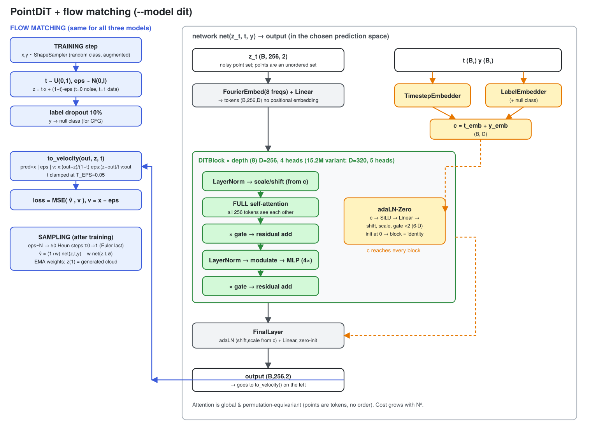
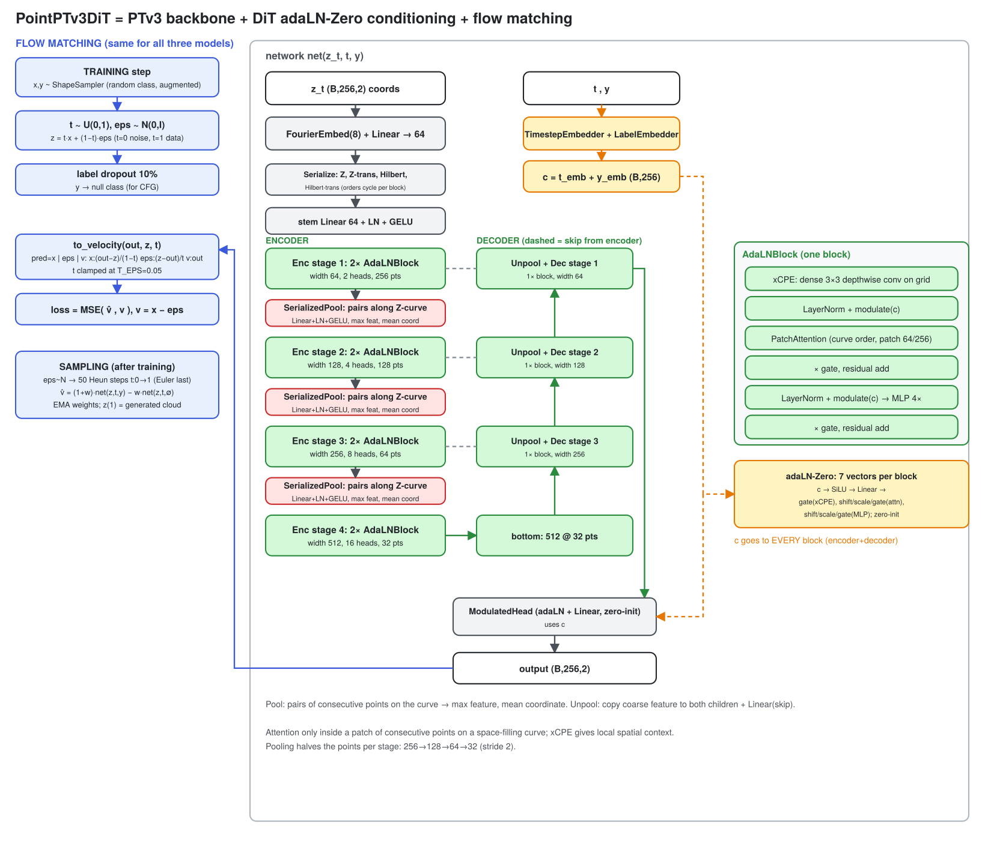

## DiT architecture

## PTv3 simple architecture

## PTv3 + DiT architecture combined

## Model settings:
1. Data: 256 points, full rotation, scale 0.6 - 1.0, translation ±0.3, jitter 0.01
2. Flow matching: clamp 0.05, label dropout 0.1
3. Optimisation: AdamW, lr 1e-4 no schedule, weight decay 0, batch 128, gradient clipping 1.0, EMA 0.999, 10k 0r 30k steps
4. Models: DiT with --dim 320 --heads 5 --depth 8 (15.2M param), and PTv3 and PTv3+DiT with --patch 256 (about 10M and 15.09M param)
5. Sampling and evaluation: Heun with 50 steps, no guidance, 128 clouds per class
